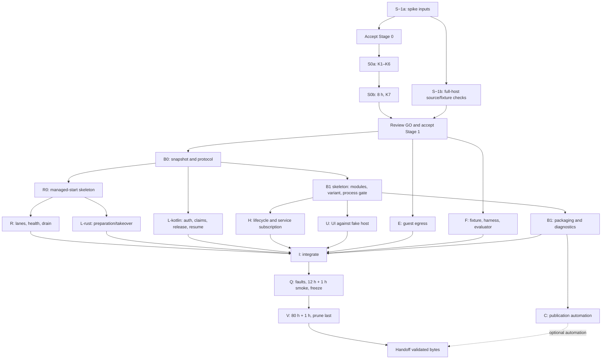

# Android host PoC — implementation plan

Date: 2026-11-03; acceptance updated 2026-11-05. Status: **Stage 0 K1–K7 measured GO; Stage 1 accepted for implementation 2026-11-05. Qualification pending.**

Contract: [ADR-034](adr/034-android-agent-host.md). Reviews:
[ADR rounds 1–3](adr/034-android-agent-host-review.md) and
[plan review](android-host-implementation-plan-review.md).
[Final-review response](plans/android-host/2026-11-03-round-3-response.md).
[Round-2 coverage](plans/android-host/2026-11-03-round-2-response.md) and the
[earlier response](plans/android-host/2026-11-03-review-response.md) are historical.
[Investigation notes](android-host-poc-notes.md) contain historical preflight
results, not evidence that the proposed host works.

The product remains opt-in and off by default. App use without the host
must start no bao foreground service or Rust worker. Host enablement means
prepared standby with an FGS; answering chat requires separate activation.
Stop host leaves the ordinary app and its Go backend usable.

This revision replaces the serial P0–P7 plan. First obtain feasibility
results from **Stage 0**, then decide whether to build **Stage 1**, the full
always-on host. ADR-034 owns behavior and numerical gates; this document
owns work order, deliverables and collection. Under the repository's
[ADR rule](adr/README.md), code may start only within an explicitly accepted
stage. Stage 0 passed its measured gate; the user accepted Stage 1 on
2026-11-05 with “lets go for stage 1”. Implementation proceeds in the tracks
below. Source prerequisites still gate the affected integrations, and the
no-further-reboot instruction remains binding. Log human-only qualification
dependencies in [user follow-ups](plans/android-host/user-follow-ups.md).

Later test clarification from the user: run a separate local Any instance on
the Mac with its own data directory and the same throwaway account as Android.
Use that peer to send synthetic chat messages and observe synced replies, with
Android as the only Bao host for the account. This belongs to the later
end-to-end host check; direct JNI fixture turns do not establish watcher/sync
delivery. Keep account recovery material local and preserve the existing
desktop data directories. This clarification does not accept Stage 1 early.

## S−1a — Stage-0 inputs before acceptance

Read-only inventory informs acceptance; it is not a full-host gate:

- Record Phone (2a) model/RAM, API/extensions, page size, fingerprint,
  security patch, BOOT_COUNT, GMS/APEX versions, lock/inactivity-reboot
  and background/battery settings. Do not infer the OS from “latest.”
- Reserve a supervised phone/Mac window. Use a new
  `org.any.anykotlin.baoPoc` installation in an isolated checkout, never
  benchmark's `.dev` slot. Leave the devpass account, network and data
  intact; prevent concurrent devpass/server use. If that cannot be
  arranged, a separate device is required. No wipe/re-login workaround.
- Recheck Rust/NDK/SDK pins, JDK 17, Gradle/Python, artifact credentials and
  disk. Record availability, not secrets. No silent toolchain substitution.
- Identify the AAR/source pin and the data routes needed by the spike.
  Prepare the synthetic fixture with the matching desktop binary and
  existing tooling: hashed guest-source bundle/spec map, immutable context
  templates and fresh isolated per-turn copies, including history/memory
  and normal skills/docs. Preseed the copies before timing; desktop
  calibration resolves the identical bundled source bytes. Verify the
  spike's progress-publish route here. Keep desktop anyrt stopped for phone
  turns. Stage-1 registry/prune/global-P2P verification belongs to S−1b.
- Freeze the §0 input/output recipe: masked phone-key entry, desktop canary
  using the same local key as explicitly chosen by the user on 2026-11-03
  (record shared quota), in-memory tier/profile seeds, file/in-memory traces,
  external-files export with a verified SAF fallback, and on-screen Go
  port. Calibrate all ten fixed toolcaller inputs on desktop. Test the
  canary once per minute during the phone batches and record retry/status
  and quota evidence. No real connectors or production overlays.

**ADR-034 Stage 0, K1–K7 was accepted for implementation on 2026-11-03**,
including the previously chosen 8-hour probe. Stage 1 was separately accepted on 2026-11-05.
Acceptance is recorded in the ADR/index; add only relevant native/fixture
pointers. S−1a measurements remain required before the corresponding run. The initial build must prove the export/key/port
channels before any measured run. A failed channel is not a K pass.

## S−1b — Stage-1 prerequisites, inspected alongside S0

Obtain exact pinned Any AAR source (currently v0.3.5) in an isolated
checkout, never move the user's sibling checkout. Recheck tag/commit/AAR
hash, health/auth, techSpaceId, spaceIndexObjectId, both sync-status routes,
self-upsert merging, claim/seq/at retention and 409 device.pruned. Include
pruned-row visibility, global P2P/iroh/pkarr/direct paths and Go-side push
traffic. Earlier local v0.2.3-nightly.20260925.1 citations remain provisional.
An unavailable/incompatible pin blocks the affected stage, not permission
to invent endpoints. Refreshing tracked OpenAPI inputs and building changed
bindings are Stage-1 implementation work after acceptance, not inventory.

Prepare the full fixture/reservation proposal in
[environments.md](environments.md#android-poc-proposed). If inactivity
reboot is enabled, resolve the 80-hour locked contract before the long
qualification campaign: a setting change, recorded unlocks or a shorter claim needs an
explicit user choice/contract revision. Keep the secure lock. No device
reservation, source fetch, setting change or provisioning is claimed by
this document.

## S0 — Native feasibility, then the early background probe

Follow [ADR §0](adr/034-android-agent-host.md#0-staged-acceptance-and-feasibility-gate)
for the canonical inputs, metrics, budgets and outcomes.

1. Create the minimal isolated `baoPoc` variant first. Remove Firebase
   providers/FCM service with `tools:node="remove"`, exclude Google Services
   generation and bind no-op token/push implementations in disjoint variant
   sources. Set SENTRY_ENABLED=false and disable Amplitude in main and
   worker. Add the test screen/plain bound `:bao` worker; skip its main
   graph/Go. S0a requires a visible Activity; leaving it retires the worker.
2. Split compiler/runtime Cargo features with defaults disabled on both
   Wasmtime dependencies, an explicit desktop default, optional tiny_http/
   control/OAuth and bin required-features. Use one locked graph, separate
   host/target invocations and the shared EngineProfileV1 including explicit
   stack sizes. Verify affected desktop/default/shell and any-ui consumers.
3. Build the trusted AOT artifact and JNI adapter over `run_program`.
   Include the recording-only limiter, two idle stores, temporary
   toolcaller tools-off option/guard and `LocalDirResolver` over verified
   bundled assets with the fixed spec/alias map. Reuse MemTraceStore under
   a spike-only feature with bounded drain/export; add key/config adapters
   and the narrow fixture-data allowlist. No space-backed code resolution.
   Do not wrap serve::start, run_config_store or AnyTraceStore.
   Preserve real prompt/history/autorecall
   work and provider calls; validate their traces on desktop before phone.
4. Preserve symbols/build IDs, JNI keep rules, unwind boundaries and local
   logs. Install the library directly; no CI AAR publication prerequisite.
   Compare two clean source-kernel builds, or freeze recorded bytes when
   reproducibility is not established. Sanitize WASMTIME_* only in the
   precompiler. Build the second trusted trap component and verify its
   signal path, per-case fuel, epoch and stack classifications.
5. Prove key entry, captured port and export round trip on the exact build.
   Collect K1–K6: ten fresh processes (first after reboot labelled cold),
   200 classified cases, empty/loaded baselines and ten seeded toolcaller
   turns with two idle stores, each in a fresh context copy isolated from
   previous output/recall bookkeeping. Verify actual context hashes against
   the template with declared ID normalization. Include total/delta memory,
   guest allocations, caller latency and union-of-provider-wait intervals.
   No result without
   these measurements is GO. Two invalid turn batches are INCONCLUSIVE.
6. After K1–K6 pass, implement only S0b's minimal opt-in foreground owner,
   persistent notification/Stop and timed wake lock. Verify battery settings
   through the user-facing setup flow. Keep the same fixed account/session
   and templates; preseed one isolated copy per turn and run 32 turns over
   8 hours on external power with the screen locked (ADR §0 also permits the
   recorded, mains-powered Mac-USB setup requested on 2026-11-05). Add the spike-local main
   `POST /v1/events` call now; its at-most-once progress is an operator alert
   channel. Decide K7 from durable local progress/wake/process/turn records,
   not remote delivery gaps. No automatic restart, boot, election or
   full-host modules. Apply K7 and its bounded retry rule.

**Gate:** report GO / PIVOT / STOP / INCONCLUSIVE against all K criteria.
At most two profile corrections and two K6 batches; K7 has its own one
external retry. Host/resource failures are never erased by another batch.
S0b is an input to Stage-1 acceptance, not an 80-hour acceptance substitute.
No shared-process/JIT/Termux fallback. Full host engineering follows only
a reviewed result and explicit Stage-1 acceptance.

Write the K1–K7 report using the [S0 template](plans/android-host/s0-report-template.md),
with `run-manifest.json`, raw `k-values.json` and referenced exports beside
it. The pre-acceptance Stage-1 freeze ended on 2026-11-05. Preserve Stage-0
evidence; complete S−1b's v0.3.5 checks before affected integration and conduct
the requested implementation reviews against measured results. Prefer
removing unnecessary mechanisms.

## Stage 1 — Accept the host, then use dependency-based tracks

After reviewing S0, explicitly accept the remaining ADR and proposed
campaign cap. Resolve security-setting and device-reservation prerequisites,
then add the full reciprocal ADR pointers. Freeze the RuntimeSnapshot and
complete protocol enum in **B0** first. Other work can then proceed against
that contract and test doubles; completion of an unrelated track is not a
prerequisite. Each track has its own review gate and paired source hashes.

B1 owns the Application/process-gate skeleton before H edits lifecycle
hooks there. R0 owns the managed-start seam in serve.rs before L-rust
splits its writes; later R/L changes to shared files land sequentially.
U can build against fakes after the module/API skeleton; real subscription
integration requires H. These are dependency tracks, not authorization to
have multiple owners edit the same function concurrently.

### B — Host boundary, variant and diagnostics

**B0 first:** expose core/app RuntimeSnapshot `(mainNonce, generation,
baseUrl, gateOpen)` and transition hooks, keeping the mutex private. The
main supervisor binds authEpoch/account/selfPeer into Lease after validated
HTTP auth; login can change inside a Go generation. Freeze all ADR
§7 messages: start/status/activate/release/setAdmission/stop and their
acknowledgments. Main owns the 5 s strict auth/sync/registry monitor,
durable intents, activation/release writes and host-ready beats; Rust owns
execution. Add any missing Kotlin publish-event client binding from the
pinned API. Fake-worker tests establish sequence/lease rejection before
native integration. Snapshot publication cannot wait until lifecycle work
is nearly complete.

**B1 skeleton first:** add host API/impl modules and the opt-in baoPoc variant with its own
ID, explicit fallbacks, disjoint unavailable/real DI bindings and scoped
AAR/permissions. Complete the ADR's FCM-free path begun in S0 before its first host build:
exclude Google Services generation, Firebase providers/auto-init/FCM service
and all Android token registration/deletion calls with `tools:node="remove"`
and disjoint no-op push bindings. Record expected Go push-node traffic from
the pinned source; Go push traffic has its own inventory. Test normal
variants' push separately. Check getProcessName before super.onCreate and
use Hilt CustomInject only in main; the worker is not an AndroidEntryPoint.

**B1 completion:** set shell-profileable on baoPoc. Use the Android Cargo profile, build IDs,
JNI/R8 rules, Kotlin-to-native polling, panic reporting, local tracing and
bounded file log tree in ADR §2. Prove collection/decoding/symbolization
of a deliberate native crash, with no Sentry dependency. Preserve every
Java/Rust/Go symbol/mapping needed by the qualified build.

Local AAR/APK packaging is mandatory; remote CI publishing is track C.
Record hashes and Gradle verification metadata so mavenLocal cannot silently
replace the pinned artifact. Keep default/shell Rust and the any-ui path
build in the regression matrix. Add positive-controlled release/baoPoc
manifest/dependency/APK checks. Run 16 KB T1 checks here and on the final
artifact: getconf PAGE_SIZE=16384, compat mode off, zipalign -c -P 16 and
ELF LOAD alignment at least 2**14 for every packaged native library.
Emulator loading is not evidence of phone FGS/Doze behavior.

### R — Managed runtime, bounded resources and health

**R0 first:** introduce the managed-start/preparation handle before blocking
boot, cancellation ownership and the agreed hooks for L-rust. This is the
shared serve.rs skeleton, not finished election/preparation policy.

**R completion:** refactor runner/config/lib/triggers and remaining service
loops around it. Own every boot helper, watcher,
stream, retention/presence/election loop, run/store and join. RAII cleans
up mailbox/run state; collect all failures after a panic. Atomic health
never takes HTTP-held/poisoned service locks; publish wait class/deadline.

Implement the three lanes and aggregate limiter together with deferred
scheduler/event admission, so a capacity cap cannot consume a once shot
or increment failure counters. Bound pending work and prioritize the
heartbeat among due jobs. Move scheduled runs off the supervisor ticker;
stop the 10 ms epoch ticker while no store is live. Keep operation-class
HTTP budgets; a drain deadline retains ownership and lets H kill the
worker. Do not promise cancellation of a blocked resolver/socket.

Gate: StubTransport/FakeSpace/replay tests cover boot cancellation, blocked
HTTP/DNS/SSE, sleeps, panic and thread accounting; saturation preserves
once/cron/event state. Measure PDF/mock-mail peaks and idle CPU/timer wakes.
Android time.now, absolute paths, disabled control server and unsupported
OAuth/local grants are explicit embedder policies. Do not integrate the
unrelated untracked ChatGPT work to implement an unsupported capability.

### E — Guest network boundary

Inventory HTTP/provider/MCP paths (MCP is guest mcp@v1 using broker HTTP).
Build an explicit method/path allowlist from pinned OpenAPI and server
routes, independently of routes.rs's replay classifier. Normalize URLs,
reject ambiguous encoding, validate/pin DNS/IP destinations and every
redirect, and isolate trusted host management. Denials remain traced;
offline replay performs no DNS/credential/network side effect.

Gate: direct/redirect/rebinding/IPv4-mapped IPv6/encoded-path/alternate-port
probes cannot reach a second local listener or registry/auth/debug/import
routes. Valid fixture data and public HTTPS/IPv6 model calls succeed.
Reject configured LAN/private MCP or model endpoints before activation.
No unrestricted live guest or model-driven tools before this gate.

### L — Split Kotlin policy from Rust preparation/execution

**L-kotlin (any-kotlin, after B0):** main owns strict auth/sync/registry
monitoring, auth epochs, readiness and host beats, one-time name seed,
activation substates and durable ReleaseOwed/resume history. Retry releases
whenever matching-account Go runs, including host-off normal app use.
Implement §5's ClaimWritten/Open/BeatSeen deadlines and conservative
incomplete-history resume; worker callbacks cannot write registry state.
Tests cover Off/death before release, lost claim response, post-Open beat
failure, offline takeover/removal, prune, and account replacement.

**L-rust (anybao, after R0):** split preparation/Open/explicit-setup writes
according to ADR §5, including device-local trace collection creation.
Check takeover errors; stamp standing/chat-watch ownership before dispatch,
reconcile descriptor rows only at Open and implement complete stand-down.
Drive verdict.active from host admission; require chat-watch ownership.
HostControlled never starts election_thread and never writes `/v1/devices`;
assert that at its HTTP boundary. Fence boot and periodic reconciliation,
including pinned jobs, while keeping DesktopDefault unchanged.

Gate: fake/server and paired-device tests cover both state machines,
strict missing fields, old idle sync timestamps with fresh reads, both
sync evidence levels, lease/auth changes, failed release/claim, downtime
claim supersession, ambiguous history and backlog deduplication. An
unconfirmed/possibly committed turn is never automatically replayed.
Fixture credentials/config are ready before capability checks.

### H — Foreground lifecycle and cold account recovery

Build after the B1 skeleton, against B0's fake worker while R/L proceed. Implement promotion,
notification states/Stop, bounded oneway senders, session retirement,
unbind-before-kill, process-death proof and orphan retirement before Go.
Audit every entry: prewarm, ensureStarted/StartSuperseded, stopUntrackedServer,
logout, account/network replacement, rebuild and same-process error retry.

Add the durable pending-operation journal and fresh-process recovery, with
session/push/cache/secure-storage cleanup semantics preserved. Never wipe
from Mobile.stop success. Show the pre-recycle message and fresh recovery
screen described in the ADR; measure actual Nothing relaunch behavior.
A cancelled ViewModel waiter cannot cancel cleanup ownership.

Implement pre-Hilt exit/journal/breaker checks, failed-bind accounting,
expected-exit summaries, bounded restart and sticky/non-sticky behavior.
Add opt-in after-unlock/boot/update paths, wake lock and gated backstop,
RSS admission/hysteresis and thermal limits. Host-off, explicit Stop and
force-stop cannot be overridden by any path.

Land the DUMP-protected seam alongside the faults that need it; its full
one-page contract is in ADR §6. Extend FakeMobileBridge/AnyRuntimeImplTest
and AppCoordinatorTest, then prove real death/race behavior externally.
Update the auth/runtime vertical and relevant comments in the same change.

### U — Strict readiness, Devices UI and normal app behavior

Reuse the existing account/space/object-sync API but add strict field-presence
decoding: AnyHealth's current default false cannot certify bootstrap.
Main's service owns status subscriptions; WhileSubscribed on an open screen
cannot determine host liveness. Keep the current-session freshness rules.

Extend core-models BaoDevices and tests, BaoStatusSource, AgentDevicesViewModel
and UI using existing design-system controls/localized strings. baoPoc
self-activation must use the host's staged claim/Open/beat policy, never
the screen's direct activate/20 s Claim-again path. Keep other variants
and remote-device display behavior. Test fake status before integration.

Gate: with host off, login/chat/navigation work with no bao service/worker;
remote bao can answer. With host on, standby and active are distinct;
notification denial does not remove in-app Stop. Reopening the UI changes
no runtime generation. Update the bao-status vertical with these changes.

### F — Fixture, test harness and evaluator

Build these tools before asking an operator to execute acceptance tests.
Use proposed `tools/android-poc/` for host scripts, network rules, collectors and
a deterministic evaluator implementing the proposed
[evidence schema](plans/android-host/evidence.schema.json),
[arm manifest](plans/android-host/arm-manifest.json) and
[predicate catalog](plans/android-host/evidence-predicates.md); `tests/android-poc/` for evaluator
fixtures; and a separate test/probe APK under any-kotlin test tooling.
These paths are deliverables, not existing commands.

- A host-side adb runner owns lifecycle tests. Never instrument the app
  under test for death/exit-reason arms; whether instrumentation itself
  force-stops this device is an empirical question, not an assumption.
  JVM tests cover pure logic. Reuse StubTransport, FakeSpace, replay,
  FakeAnyClient, FakeMobileBridge and real-server tests with explicit
  ANY_INTEGRATION_BIN pinned to the AAR source. Unexpected self-skips fail
  the fixture gate.
- The separate-UID probe APK has no DUMP permission. It hosts the second
  synthetic loopback listener, attempts forbidden guest/receiver access,
  and produces uniquely labelled test traffic as a positive capture
  control. It contains no personal account or secrets. Add a separately
  enabled VpnService telemetry mode with baoPoc-only routing and per-flow
  UID attribution; prove IPv4/IPv6 TCP/UDP coverage, then remove it before
  outage/soak testing. Per-UID netstats are corroboration, not destination
  attribution. Go/Rust share the app UID.
- Implement the dedicated network fixture in environments.md: separately
  controllable phone/desktop sync and provider paths, both IP families,
  nodeconf peers, iroh/pkarr relays, dynamic direct P2P, LAN/mDNS discovery,
  encrypted DNS and bounded router restoration. Use a phone default-deny
  sync-partition rule with verified provider exceptions. Prove all three
  peer counts are zero, no desktop phone peer and no canary convergence.
  Verify fault isolation and capture coverage in a dry run. Unrooted
  phone-wide Wi-Fi toggling alone is not a selective sync outage.
- Run-id-keyed bundles include immutable build/config/overlay hashes,
  clock/boot/process/session identities, action log, exit/tombstone evidence,
  samples, phone exports, sender replies, heartbeat occurrences, network
  captures and provider/sync/sender canaries. Redact keys without printing
  a match; do not export real databases. Partial bundles remain preserved.
- Continuously collect host status, exporter freshness/seam state and
  heartbeat records through the desktop peer. For smoke/soak, warn on
  host/diagnostic beats 30 s stale and invalidate at 60 s; hourly export
  grace ends at 65 min. Probe/heartbeat deadlines and resource samples
  have their own ADR limits. A local console stops invalid runs; this sends no external message.
  Sender time uses a sleep-inclusive monotonic clock (mach_continuous_time
  on the Mac, calibrated with a suspend/resume check), paired with UTC.
- The evaluator emits PASS / FAIL / INVALID / INCOMPLETE per arm and an
  overall result. Missing/stale samples, unknown attribution, wrong hashes
  or unexecuted arms cannot pass. Split MECH computations from HUMAN signed
  evidence rulings. Implement golden PASS and failure bundles (duplicates,
  clock reboot, external outage, once loss, exporter gap), and threshold
  edges: n=320 rank-304 latency exactly 120 s versus just above; heartbeat
  exactly 21 min late versus just above. Test missing/bad signatures and
  absent predicates. Schema-valid alone is never PASS. Validate a real
  dry-run bundle before freeze; no evaluator/runtime code exists yet.

Precommit attribution rules: host evidence identifies runtime/admission/
crash failure; provider failure requires the actual request outcome or transport-error
record plus independent incident/canary/quota evidence; sync failure requires sync and network
fixture evidence; sender failure requires its own logs. A canary miss within
±5 minutes is corroboration, not sufficient attribution. Multiple or
insufficient causes remain unresolved. The user reviews classifications;
external failures invalidate a clean run, never erase a host failure.

Track C adds CI automation and artifact upload in parallel. It is not a
prerequisite for qualifying a reproducible local APK/AAR with verified
hashes. Publication uploads those same bytes, never a rebuild.

## Executors, sample sizes and observation windows

The host runner/evaluator owns timings; the operator handles labelled
manual actions. Each T row is expanded into named arms in the checked-in
manifest. Thresholds apply to the maximum unless the ADR specifies p95;
use nearest-rank p95. Android deadlines use elapsedRealtimeNanos: cold
promotion starts at Process.getStartRequestedElapsedRealtime, warm at
onStartCommand, and ends after startForeground returns. Retirement starts
when main accepts Stop and ends at proven quiescence/death. Missing clock
support requires a documented measurement revision, not an invented time.

| Test | Executor and minimum samples | Operator window |
|---|---|---|
| T1 | Host static checks + device/emulator smoke; one per exact candidate/ABI/page size; positive controls required | Install, start and crash-capture setup |
| T2 | Host runner: ≥10 cold, ≥10 warm, ≥10 Activity reattach and ≥10 host-off launches | Setup; then scripted |
| T3 | Host + seam + JVM races: 10 cycles per stop/transition class; test fresh-Activity and reopen recovery | Present for account-change UI checks |
| T4 | Fake-server tests + desktop/phone runner: ≥5 each activation/off/release/lost-claim arm | Initial explicit consent, scripted subsequent fixture actions |
| T5 | External runner: ≥5 per recoverable death/bind/early-init path; ≥3 each Recents/Task Manager/force-stop | Present for user-stop/re-enable steps; no seam wakeup after death |
| T6 | External observation: 3 reboots, each with one recorded unlock and no app opening | Present for unlock; seam off |
| T7 | Remote sender: 320 probes, 160 scheduled occurrences, 80 h + 1 h observation | Reserved devices; local alerts monitored, no UI use |
| T8 | Continuous self samplers during smoke/soak; wired host profiling only before soak; 5 each pressure/PDF/mail/capacity arm | Present for induced pressure; automatic limit stop |
| T9 | Export/sender evaluator: continuous; locked-export dry run and deliberate missing-export detection | SAF grant/setup, final pull |
| T10 | 3 sync-loss, 3 provider-loss, and 3 separate 30 min Doze arms; each Doze arm sends 3 probes (9 total) | Present throughout Doze; replug at minute 30, restore/read back by minute 32 or invalidate |
| T11 | Guest fixture + separate-UID APK/capture: full route matrix, 3 abrupt-loss takeovers, 1 uninstall/reinstall, prune last | Present for uninstall/backup/settings/prune |

Count supervisor timer wakeups with explicit per-loop counters and sampled
scheduler wakeup traces; voluntary context-switch counts are not an exact
wakeup measure. CPU includes sampling/export work. Every absence check has
a positive control: main maps contain Go, precompiler deps contain Cranelift,
baoPoc contains its fault receiver while release does not, and labelled
synthetic traffic is detected. Do not send test crashes to PROD Sentry to
validate capture. Decode APK/manifest and use R8 mappings rather than
assuming unobfuscated class-name grep is reliable.

## I/Q — Integration and qualification before the expensive soak

Integrate completed B/R/E/L/H/U/F tracks into a local candidate. Complete
server-version compatibility rejection before any live run. Demonstrate
one full phone chat-watcher turn and one scheduled heartbeat, then handoff
in both directions. The Stage-0 turn did not certify this path.

Run T1–T6, T8/T9 prerequisites, **all T10 arms and abrupt-loss/uninstall T11
before** the long soak. Use expendable identities for destructive cases;
reinstall the same candidate bytes with a new valid identity afterward.
Prune is the only deliberately deferred destructive arm. Check account/
space/peer IDs and absence of competing desktop anyrt again.

Freeze APK, AAR, symbols, native profile/source kernel, independently hashed
overlays, config/model/provider, fixture scripts and evaluator. Run a
12-hour smoke soak plus one observation hour (48 probes, 24 heartbeat
occurrences) with the same collection and thresholds, then seal the manifest
without changing bytes. Smoke catches pipeline/early regressions; it does
not establish inactivity-reboot, long-retention or quota behavior. Exercise
trace sweep explicitly in T8; retain the separate long run.
Restore battery simulation (`dumpsys battery reset`), forced idle
(`deviceidle unforce`), routing rules and fault session/fixture-seeded breaker state.
Record the restore receipt, prove seam/VPN state is off and preserve the
production-breaker evidence before clearing only fixture-seeded state. No passing smoke
window is spliced into the 80-hour test.

Gate: all pre-soak arms pass, evidence is complete, quota is at least twice
projected spend, device/Mac reservations and current versions match the
manifest, and the user reviews the qualification report. Fixes go through
the matrix below; CI publication status cannot conceal missing device evidence.

## V — Capped long soak and handoff

Run T7/T8/T9 on wall power for 80 hours and observe replies until hour 81.
Desktop anyrt stays stopped; desktop Any, sender, independent canaries and
live diagnostic monitor remain up. Abort on the first invalidating event,
retain its evidence and apply the predeclared attribution rules.

The proposed campaign uses ADR §6's **two host-candidate slots (H)** and
**three external/fixture invalidations (X)**, across smoke/long runs.
Host-attributable or unresolved failure consumes its candidate; review the
fix before using the next slot. External events do not consume H; two
consecutive X events require fixture repair/user review. A mixed host and
external failure counts H. Rebuilds do not reset either ledger. One ≤2 h
pipeline rehearsal precedes qualification and cannot substitute for a gate.
Stop/re-plan when either budget is exhausted; no silent extension. Track
provider spend; do not treat review estimates as measured calendar costs.

After a passing long run, perform final prune/stop evidence last. Publish
or hand off only the exact validated bytes and symbols, with install,
enable, Stop, recovery and limitations instructions. All T1–T11 must pass
for a full-host result. Stage-0 GO or an incomplete campaign is reported
as that narrower outcome; it is never called a working 24/7 host.

## Change-impact and rerun rules

The user approves every “unaffected” classification in the gate report;
unknown impact is affected. No retrospective threshold change rescues a run.

| Change/event | Required action |
|---|---|
| Native/kernel/profile, APK/JNI/R8/diagnostics, lifecycle/security/admission | New candidate; affected unit/integration checks, T1–T6/T8–T11 prerequisites, 12 h + 1 h smoke and 80 h + 1 h long run. |
| Rust-only fix, identical guest content | Same native rule; retain identical overlay hashes/IDs without redeploy. |
| Guest overlay, model/tier/provider or account/config policy | New fixture; readiness/handoff/egress/capacity/timing qualification and both soaks. Rebuild only changed bytes. |
| Desktop Any binary or phone AAR change | Pin matching source/CRDT on both sides; new manifest; repeat compatibility, auth/sync/election/outage gates and both soaks, plus native rules if APK changes. |
| Desktop anyrt change | Recheck takeover/calibration/source match; affected T4/T10/T11 and both soaks if behavior changes. Identical-hash relocation only needs recorded paths. |
| OS/security/APEX update or reboot | Invalidate ongoing run; lifecycle/Doze/resource gates and both soaks on measured versions. |
| GMS/Play app update without reboot | Record packages/times; user-reviewed impact ruling. No automatic invalidation for version-only change in an unused path; affected/unknown behavior requires relevant gates and fresh soaks. |
| Sender/router/exporter changes | Golden/control checks and affected arms; timing/collection changes require new smoke/long evidence. User may accept unaffected preserved data only with proof. |
| Evaluator defect after collection | Preserve original verdict/version; fix and run golden/boundary suite, re-score immutable raw data if all required fields/hashes exist and collection was unaffected. Commit both verdicts and user ruling; otherwise recollect affected arms/soaks. Never rewrite raw evidence. |
| Nodeconf/DNS/IP drift | Re-resolve inventory and dry-run partition/provider controls; update manifest. Invalidate an active affected outage/run; unknown routing coverage is affected. Default-deny still needs verified provider exceptions. |
| Same-tier provider key rotation | New credential ID/manifest without key values; recheck readiness/quota and calibration, then fresh smoke/long run if rotated during qualification. No APK rebuild solely for the key. |
| Phone setting drift (battery exemption, Private DNS, VPN, power/lock) | Stop affected run, restore/read back, repeat setting-dependent Doze/egress/resource gates and soaks. |
| macOS update/restart/sleep | Invalidate ongoing sender evidence; clock/suspend, sync/provider/network and export dry run, then fresh smoke/long run. |
| External outage, unplug, evidence gap, seam enabled or unknown attribution | Abort, preserve, classify in H/X; repair within the unchanged campaign budget. Unknown attribution consumes H. |
| Prose-only clarification or upload of identical bytes | Record hashes; no executable requalification. |

## Reports and source ownership

Write per-gate reports under `docs/plans/android-host/reports/<gate>-<date>.md`
and link them from the PoC notes. Include source/artifact/fixture hashes,
commands, sample sizes, results, evidence paths, failures/skips, decision
and next entry conditions. Commit sanitized `verdict.json`, expanded
`arms.json`, signed `rulings.json`, `restore.json`, `sha256sums.txt` and the
exact evaluator command/version alongside each report. Keep two verified
raw bundle copies outside git until handoff; keys stay outside both. A report
is not claimed until execution, and schema examples are labelled synthetic.

anybao owns runtime/build/egress, L-rust hooks and host harness/evaluator;
any-kotlin owns L-kotlin policy/registry writes, host modules and
Application/runtime/client/model/UI changes,
variant diagnostics and the test APK. Existing relevant test locations are
runtime/tests and testutil.rs, AnyRuntimeImplTest, AppCoordinatorTest,
AnyHealthDecodeTest, BaoDevicesTest, BaoStatusSourceTest,
AgentDevicesViewModelTest, EventsDevicesIntegrationTest and
SyncStatusIntegrationTest. Update vertical docs alongside each affected
code change. No named maintainer or issue is invented.

Upstream any authentication and bounded Go drain remain later work under
the chosen fallbacks, **conditional on S−1b verifying the pinned API**.
All-route authentication is mandatory before any real-account hosting.
Stage-1 shutdown still uses the dated PoC cold-process exception in the
ADR. The round-2 response maps IP2-1–IP2-30 to this revision; the earlier
response retains the historical IP-1–IP-25 and R3-1–R3-6 dispositions.
